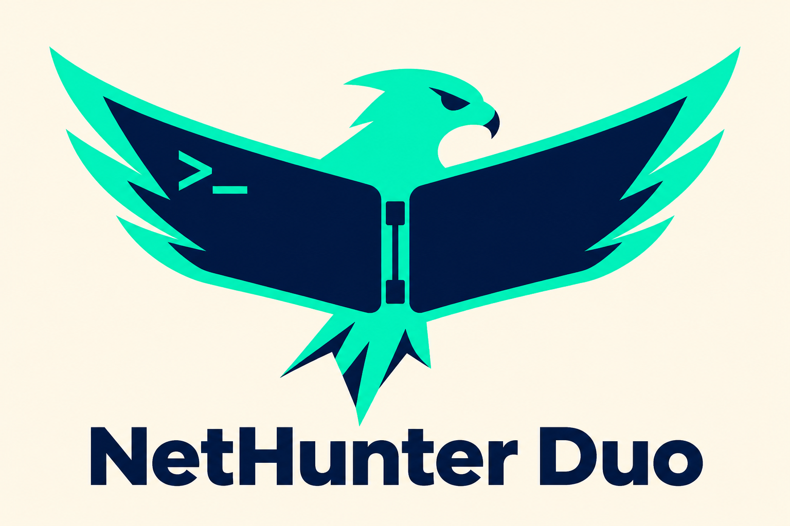

# NetHunter Duo

NetHunter Duo is a community-maintained kernel and field toolkit for the first-generation Microsoft Surface Duo on stock Android 12 build `2022.902.48`. Use the Kali shell to reach servers over SSH, connect to serial equipment, or present the Duo as a USB keyboard, network adapter, or read-only drive.

| Starting point | Guide |
|---|---|
| Build from source | [Local Linux or WSL2 build with Docker](docs/development/build.md) |
| Set up a Duo | [Installation](docs/installation/install.md) · [Recovery](docs/installation/recovery.md) |
| Use a configured Duo | [Field guide](docs/operation/field-guide.md) · [USB profiles](docs/operation/usb-profiles.md) |
| See what was tested | [Hardware compatibility and verification](docs/reference/compatibility.md) |

The kernel build runs on your own x86-64 Linux or WSL2 machine. Docker supplies the compiler environment and the build scripts reuse local sources, toolchains and outputs. The Android launcher has its own Gradle build. Start with the [handbook](docs/README.md) for prerequisites and commands.
