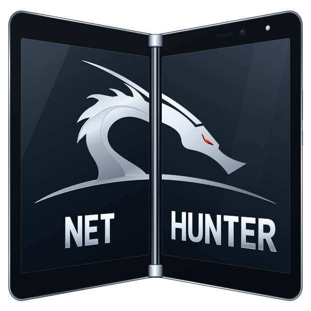

# NetHunter Duo

  

NetHunter Duo turns a **first-generation Surface Duo running stock Android 12L** (firmware `2022.902.48`) into a pocket Linux workstation. Open Kali on the Duo, plug it into a Windows PC for a private SSH link over USB, or use it as the PC’s keyboard and mouse.

[Download the prebuilt kit](https://github.com/IAmStoxe/nethunter-duo/releases) · [Install on a Surface Duo 1](docs/installation/install.md#use-a-prebuilt-release) · [Build with Docker](docs/development/build.md)

## What worked on the Duo

| Feature | What the test confirmed |
|---|---|
| **Kali and Android launcher** | The full ARM64 Kali NetHunter environment ran on the Duo and its package database passed verification. The companion Android launcher installed, opened, and rendered on the device. |
| **SSH over a USB cable** | The Windows host obtained an IP address over USB (RNDIS), pinged the Duo, and opened a key-only root SSH session after verifying the Duo’s host key. |
| **USB keyboard and mouse** | Windows received the exact text typed by the Duo and recorded a relative mouse movement. The Duo then switched back to Android USB debugging (ADB). |
| **Internal Wi-Fi** | The built-in radio entered monitor mode on channel 149. Its firmware reported successful transmission of a broadcast probe in the packet-injection self-test. Independent over-the-air reception remains unverified. |
| **Serial, storage, MIDI, and audio over USB** | Windows started the Duo’s USB serial (ACM), network (NCM), read-only storage, MIDI, and USB Audio Class 2 interfaces. Each profile returned control to ADB. Audio playback and recording still need listening tests. |
| **SocketCAN** | Kali sent and received a CAN frame over the Duo’s virtual CAN interface. Physical CAN adapters still need bench testing. |
| **Persistent boot** | The installed kernel survived an ordinary reboot, loaded the required vendor modules, and passed the runtime smoke test. All 2,194 audited stock kernel symbol requirements matched. |

These hardware results cover kernel **#8** and toolkit **1.4.1**. The **1.4.2 prerelease** ships the same kernel and binary payload. Its stricter SSH policy and installer checks passed offline tests and await a fresh on-device install. The compatibility guide also records which external Wi-Fi, serial, Bluetooth, and SDR drivers were built or loaded and which peripherals still need testing. [Full hardware test record](docs/reference/compatibility.md)

## Setup and operation

| Starting point | Guide |
|---|---|
| Set up a Duo | [Installation](docs/installation/install.md) · [Recovery](docs/installation/recovery.md) |
| Use a configured Duo | [Field guide](docs/operation/field-guide.md) · [USB profiles](docs/operation/usb-profiles.md) |

The kernel build runs on your own x86-64 Linux or WSL2 machine. Docker supplies the compiler environment and the build scripts reuse local sources, toolchains and outputs. The Android launcher has its own Gradle build. Start with the [handbook](docs/README.md) for prerequisites and commands.
